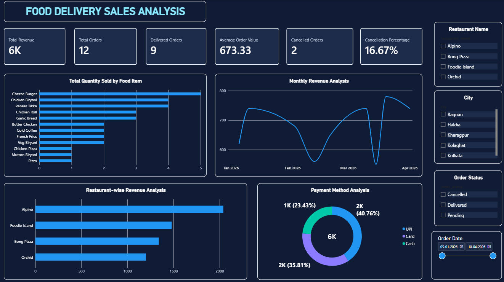

# 🍔 Food Delivery Data Analysis

## 📌 Project Overview
A data analysis project using **MySQL and Power BI** to analyze food delivery orders, revenue, customer behavior, and restaurant performance.

## 🛠️ Tools Used
- MySQL
- Microsoft Power BI
- SQL

## 🗄️ Database Tables
Customers, Restaurants, Food_Items, Delivery_Partners, Orders, Order_Details, Payments.

## 📊 SQL Analysis
- Total Orders Analysis
- Revenue Analysis
- Restaurant-wise Sales
- Customer Analysis
- Food Item Analysis
- Payment Method Analysis
- Cancellation Analysis

## 📈 Power BI Dashboard

## 🎯 Project Objective
To gain business insights from food delivery data through SQL queries and interactive Power BI visualizations.

## 👨‍💻 Author
**Sanglap Das**
